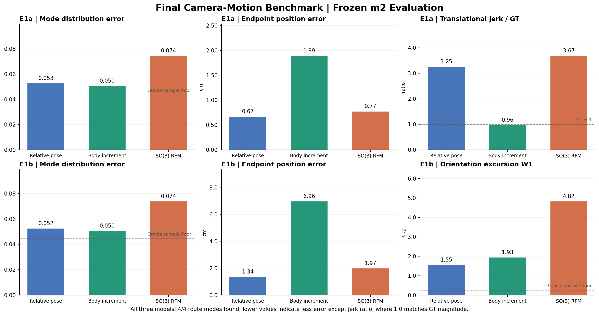
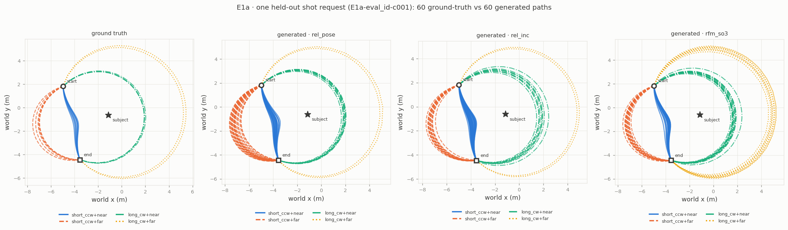
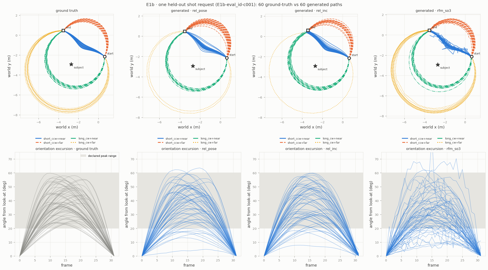

# Geometry-Aware Generative Modeling for Controllable Cinematic Camera Motion

**Flow Matching · Synthetic Camera Trajectories · SO(3) Transport Diagnostics**

This repository studies whether relative-pose, body-frame increment, and explicit SO(3) Riemannian transport lead to different trade-offs when generating **multimodal 3D camera trajectories**. It includes the synthetic benchmark, model implementations, evaluation scripts, diagnostics, curated results, and rendered demonstrations.

**Main conclusion.** Body-frame increments reproduce the ground-truth scale of translational jerk much better on E1a but accumulate larger endpoint errors. SO(3)-aware transport guarantees on-manifold rotation states, but under this particular training setup it fits the E1b orientation-excursion distribution worse than the 6D relative-pose baseline. An additional no-retraining diagnostic suggests long, temporally rough transport from an independent Haar prior and near-cut-locus target behavior as possible contributors—**not an established causal explanation**.



## Models

| Model | Representation | Generative process |
|---|---|---|
| `fm_rel_pose` | Relative 3D positions + 6D rotations | Euclidean Flow Matching, decoded rotations orthonormalized |
| `fm_rel_inc` | Body-frame positional/rotational increments | Euclidean Flow Matching, increments integrated to a trajectory |
| `rfm_so3` | Relative SO(3) rotations + relative 3D positions | Geodesic SO(3) Riemannian FM + Euclidean positional FM |

The initial camera pose is anchored, and the specified endpoint is a **soft condition** rather than an exact projection. Historical absolute-pose FM was exploratory under a different evaluator and is **not** included in the main matched comparison; its checkpoint was not retained.

## Benchmark at a glance

**Frozen evaluation:** E1a/E1b synthetic data, `m2`, 200 samples per condition, Euler NFE 50, one training seed per model. The numbers below are for the held-out (ID) panel; all models found four out of four route families.

| Metric | `fm_rel_pose` | `fm_rel_inc` | `rfm_so3` |
|---|---:|---:|---:|
| E1a TV5 ↓ | 0.0526 | 0.0504 | 0.0743 |
| E1a endpoint position median ↓ | **0.67 cm** | 1.89 cm | 0.77 cm |
| E1a translational jerk / GT (1 = same scale) | 3.25 | **0.96** | 3.67 |
| E1b TV5 ↓ | 0.0524 | 0.0504 | 0.0738 |
| E1b endpoint position median ↓ | **1.34 cm** | 6.96 cm | 1.97 cm |
| E1b orientation excursion W1 ↓ | **1.55°** | 1.93° | 4.82° |
| E1b amplitude support violations ↓ | 5.52% | 5.27% | 14.63% |

TV5 is the 5-category total-variation distance from the known route distribution (4 routes plus unassigned). Its oracle sampling floor is ~0.043–0.045 at K=200. The small difference between `fm_rel_pose` and `fm_rel_inc` TV5 has a paired 95% CI crossing zero: **we do not claim that either model is definitively superior on mode TV5.** E1b cross-model jerk / GT was historically evaluated with different ground-truth reference sets and is **not** used as a matched comparison; E1a jerk is matched.

See [research report](docs/RESEARCH_REPORT.md), [Korean benchmark notes](docs/BENCHMARK_KO.md), and [reproducibility guide](docs/REPRODUCIBILITY.md) for full details.

## Figures and demonstrations

**E1a — four route modes:**



**E1b — route geometry and pan/roll excursions:**



Watch the synchronized comparison clips:

- [E1a: three-model camera-motion demo](results/demo/E1a_three_model_synchronized.mp4)
- [E1b: three-model pan/roll comparison](results/demo/E1b_three_model_synchronized.mp4)

The MP4s use pre-existing rendered samples for the same held-out shot condition. Samples are independent and not path-paired. The scene is a simple renderer demonstration, not a photorealistic video-generation benchmark.

## Installation and verification

Supported Python versions: **3.10–3.12**. GitHub Actions runs the full test suite on Python 3.10, 3.11, and 3.12.

```bash
python -m pip install -r requirements.txt
python -m pytest -q -p no:cacheprovider
# Small, training-free reproduction of the path diagnostic:
python scripts/diagnose_so3_transport.py --out outputs/diagnostics/so3_transport --n 40 --n-train 200
```

Alternatively, use `python -m pip install -e .` to install the package in editable mode. Package dependencies are read from `requirements.txt`.


The full diagnostic uses the default `--n 1000 --n-train 10000`, optionally supplied with existing solver-sweep JSON files. `notebooks/` contains archived Colab training/evaluation workflows for the three models. Some notebook comparison cells require prior runs and checkpoints; the standalone model scripts can instead be run with their own `--help` options. Trained checkpoints are **not** bundled; retraining is required to regenerate *new* model samples from scratch. Existing numerical evidence, diagnostic outputs and rendered clips are preserved under `results/`.

## Repository map

- `camera_motion/`: data, SO(3) geometry, models, metrics, raster renderer
- `scripts/`: train, evaluate, compare, diagnose and render
- `notebooks/`: model-specific Colab workflows; historical absolute-pose experiment in `notebooks/archive/`
- `tests/`: regression tests, geometry numerical checks and diagnostic tests
- `results/benchmark/`: figures, original benchmark CSV and matched bootstrap comparisons
- `results/diagnostics/so3_transport/`: RFM path-geometry analysis
- `results/demo/`: original model videos and synchronized comparison clips
- `docs/`: research report, Korean benchmark note, reproducibility and limitations

## Research limitations

One training seed, synthetic orbit trajectories, different model priors/representations/integrators, and no human cinematic-quality evaluation. The SO(3) diagnostic is **path-level evidence** and includes an untrained correlated-prior counterfactual—not a controlled causal study of training performance. We preserve the unfavorable SO(3) results without post-hoc tuning to improve the reported comparison.

Released under the [MIT License](LICENSE). This is a **code-and-results research artifact**, not a checkpoint-complete, bitwise-reproducible release; the original trained weights are unavailable.
