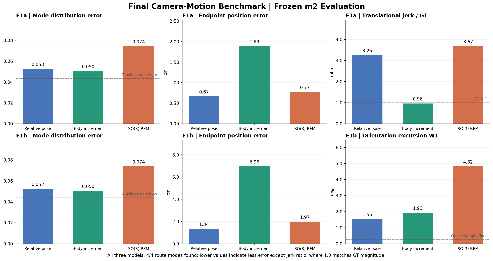
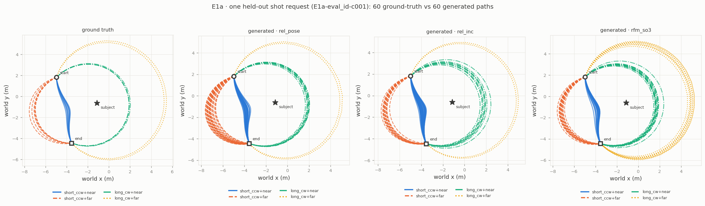
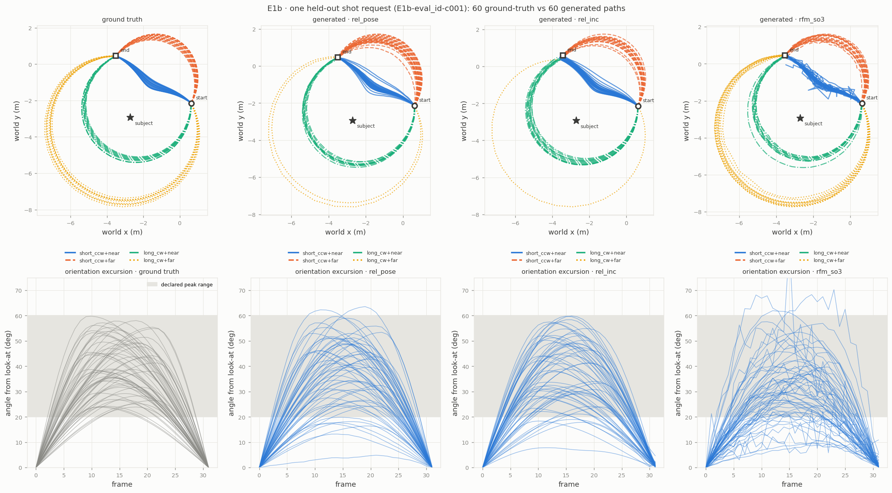

# Research Benchmark

**Research:** Geometry-Aware Generative Modeling for Controllable Cinematic Camera Motion  
**Status:** 실험 종료 · 수치 검증 및 SO(3) 원인 진단 완료 · 데모/최종 보고서 패키징 예정

## 1. 질문과 실험 설계

**질문:** 카메라 움직임 생성에서 trajectory representation과 SO(3)-aware transport는 endpoint accuracy, temporal smoothness, multimodal fidelity에 어떤 차이를 만드는가?

- `fm_rel_pose`: 상대 pose sequence를 Euclidean Flow Matching으로 생성. 회전은 연속 6D 표현을 Gram–Schmidt로 변환.
- `fm_rel_inc`: body-frame increment sequence를 생성하여 적분·누적 복원.
- `rfm_so3`: relative rotations는 SO(3) geodesic RFM, position은 Euclidean transport.
- 실험: 합성 E1a/E1b, m2, K=200/condition, Euler NFE=50, 모델당 학습 seed 1개(0).
- E1a: ID와 position OOD. E1b: ID와 orientation excursion (pan/roll 변화).

## 2. 최종 정량 결과

### E1a — held-out ID

| 모델 | TV5 ↓ | Endpoint 위치 중앙값 ↓ | Translational jerk / GT (1에 가까울수록 GT의 크기와 유사) |
|---|---:|---:|---:|
| `fm_rel_pose` | 0.0526 | **0.67 cm** | 3.25× |
| `fm_rel_inc` | **0.0504** | 1.89 cm | **0.96×** |
| `rfm_so3` | 0.0743 | 0.77 cm | 3.67× |

TV5의 finite-sample oracle reference = 0.0434. **rel_inc vs rel_pose TV5 차이 −0.0022 (paired 95% CI [−0.0095, +0.0054]); 유의한 우월성 주장 불가.** `rfm_so3` vs `rel_pose` TV5 차이 +0.0217 (paired 95% CI [+0.0136, +0.0298]).

### E1a — position OOD

| 모델 | TV5 ↓ | Endpoint 위치 중앙값 ↓ | Translational jerk / GT |
|---|---:|---:|---:|
| `fm_rel_pose` | 0.0553 | **0.63 cm** | 3.21× |
| `fm_rel_inc` | **0.0480** | 1.73 cm | **0.98×** |
| `rfm_so3` | 0.0703 | 0.74 cm | 3.69× |

OOD TV5에서 `rfm_so3`와 `rel_pose`의 차이는 +0.0150 (paired 95% CI [−0.0015, +0.03025])로 0을 포함. OOD 예시에 일반적 우열을 단정하지 말 것.

### E1b — held-out ID

| 모델 | TV5 ↓ | Endpoint 위치 중앙값 ↓ | Orientation excursion W1 ↓ | Amplitude support 이탈률 ↓ |
|---|---:|---:|---:|---:|
| `fm_rel_pose` | 0.0524 | **1.34 cm** | **1.55°** | 5.52% |
| `fm_rel_inc` | **0.0504** | 6.96 cm | 1.93° | **5.27%** |
| `rfm_so3` | 0.0738 | 1.97 cm | 4.82° | 14.63% |

TV5 oracle = 0.0445, E1b W1 oracle = 0.2527°. `rfm_so3` vs `rel_pose` E1b TV5 차이 +0.0214 (paired 95% CI [+0.0122, +0.0305]). `rel_inc` vs `rel_pose` 차이 −0.0020 (paired 95% CI [−0.0108, +0.006902]).

**주의: E1b jerk / GT는 과거 평가에서 모델 간 GT reference set이 달라 비교가 엄밀하게 matched되지 않았다.** 원본 수치(`rel_pose` 4.74×, `rel_inc` 0.99×, `rfm_so3` 12.02×)는 출처 보존을 위해 CSV에만 유지하고, 최종 비교 주장에서는 제외한다.

## 3. 대표 Figure

### Fig. 1 — Final benchmark overview

GT = Ground Truth, TV5 = declared 4-mode distribution + unassigned의 5-category total-variation distance. E1a jerk는 GT에 대한 비율이며 1이 GT 규모와 동일함을 뜻한다. 분포나 개별 trajectory의 자연스러움까지 보장하지 않는다.

### Fig. 2 — E1a representative trajectories

한 held-out shot request의 GT와 모델별 생성 경로 60개를 비교. 네 mode의 존재와 경로 모양을 직관적으로 보여주지만 전체 데이터셋의 정량 결론은 평가표에서 확인해야 한다.

### Fig. 3 — E1b representative trajectories and orientation excursions

상단: 대표 3D scene trajectory의 xy 투영. 하단: frame별 look-at baseline에서 벗어나는 orientation excursion. `rfm_so3`의 불안정한 excursion 패턴이 일부 경로에서 드러나며, 정량적으로도 W1과 support 이탈률이 높다. 대표 Figure 한 장만으로 전체 분포나 실패 원인을 확정해서는 안 된다.

## 4. 핵심 연구 결론 (강도별 구분)

### 관찰된 결과

1. **표현 방식에 따라 서로 다른 오류 형태가 관찰됨.** E1a에서 `rel_inc`는 jerk 규모가 GT에 가깝지만, `rel_pose`보다 endpoint 위치 오차가 크다.
2. **기하학적 유효성과 생성 분포 정확도는 별개.** `rfm_so3`는 SO(3) 위의 유효한 회전을 다루지만 E1b orientation excursion 분포 재현에서는 `rel_pose`보다 부진했다. 한편 6D baseline도 회전 복원 후 유효한 SO(3) 행렬을 출력한다.
3. **Mode coverage와 mode distribution fidelity는 다름.** 세 모델 모두 4/4 mode를 발견했지만 TV5는 달랐다.
4. **Solver 민감도가 존재.** `rfm_so3`의 E1b에서 Euler 20→100 NFE는 jerk와 일부 mode-bias를 개선했으나 orientation W1은 개선하지 않았다.

### 가능한 원인 — Gate 5.5 진단에서 지지된 설명 (인과 확정 아님)

- Independent Haar SO(3) prior → GT까지의 회전 이동 중앙값 약 **132°/frame**. 반면 GT의 E1b 인접 프레임 회전 중앙값은 **4.5°/frame**. *서로 다른 종류의 거리이므로 비율로 직접 비교하지 않는다.*
- RFM independent prior의 중간 trajectory는 t=0.5에서 인접 프레임 geodesic angle 중앙값 **85°**, t=0.9에서 **18°**. GT는 **4.5°**.
- Shared-Haar 반사실적 prior에서는 해당 값이 **2.5°**, **4.2°**로 감소. 이는 prior/transport 설계의 temporal mismatch 가설에 부합하지만, **해당 prior로 모델을 학습하지 않았기 때문에 성능 개선을 입증하는 결과가 아님**.
- SO(3) transport target의 약 **11.1%**가 π 회전에서 10° 이내에 위치함. Principal-log cut locus 근처의 target 불연속성이 학습상 난점을 만들 수 있으나 상대 기여도는 미분리.
- GT trajectory는 짧은 프레임 간 회전량을 가지며, 기존 Euclidean 6D 방식에서 명시적 SO(3) transport가 해결해야 할 문제가 관찰되지 않았음.

### 아직 증명하지 않은 것

- 기하학 그 자체가 성능을 떨어뜨린다는 주장.
- Independent Haar prior가 오류의 유일하거나 결정적인 원인이라는 주장.
- `rel_inc`의 낮은 jerk가 곧 더 cinematic한 영상을 뜻한다는 주장.
- 실제 촬영·영상 생성 데이터셋으로의 일반화.

## 5. 최종 요약 (보고서 본문 후보)

> In our synthetic camera-motion benchmark, relative-pose and increment parameterizations exhibited a clear endpoint–smoothness trade-off. SO(3)-aware transport maintained valid rotation geometry but did not achieve better orientation-distribution fidelity under the tested setup. Diagnostic analysis identified a long, temporally rough transport from independent Haar rotation priors, near-cut-locus velocity-target behavior, and limited geometric difficulty in the target data as plausible contributors. These observations emphasize that respecting the correct manifold is not sufficient: the prior, transport path, trajectory parameterization, and numerical sampler also matter. Our findings are exploratory and do not establish a causal explanation or across-seed superiority.

## 6. 한계와 다음 단계

- 모델당 단일 seed. Condition-level paired CI만으로 학습 seed 간 일반화/안정성을 말할 수 없음.
- 모델마다 prior, representation, transport loss, integration procedure가 함께 달라 geometry만의 효과를 분리하지 못함.
- E1b jerk 미매칭 이슈는 과장 없이 공개.
- Synthetic 3D orbit dataset; cinematic realism의 인간평가·실영상 평가는 수행하지 않음.

**Benchmark는 고정한다. 다음은 기존 output의 Cinematic Demo 선별/편집과 최종 연구 보고서·public repository 구성이다. 새로운 학습은 하지 않는다.**
