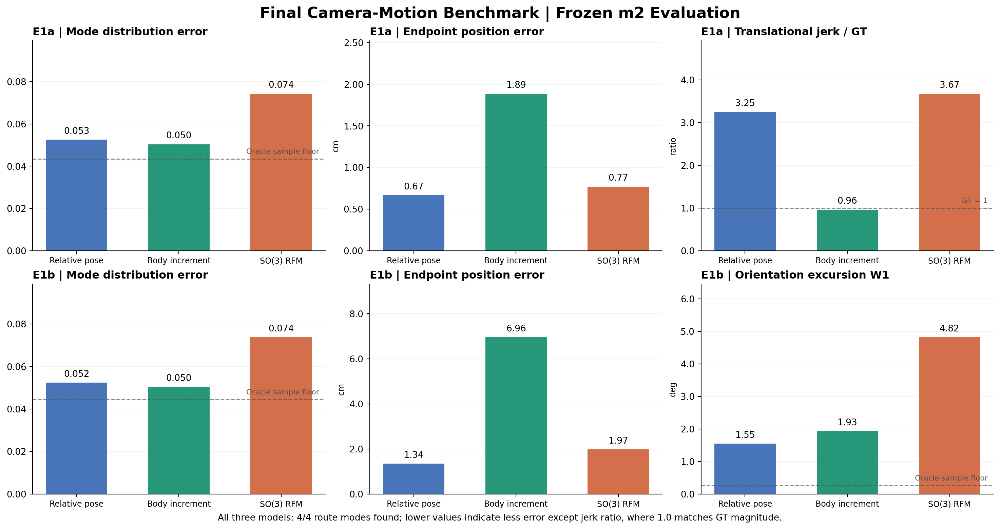
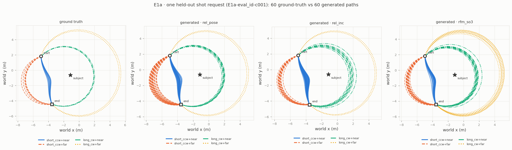
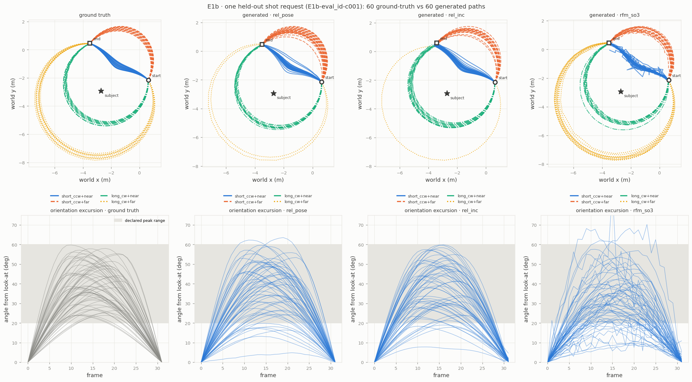
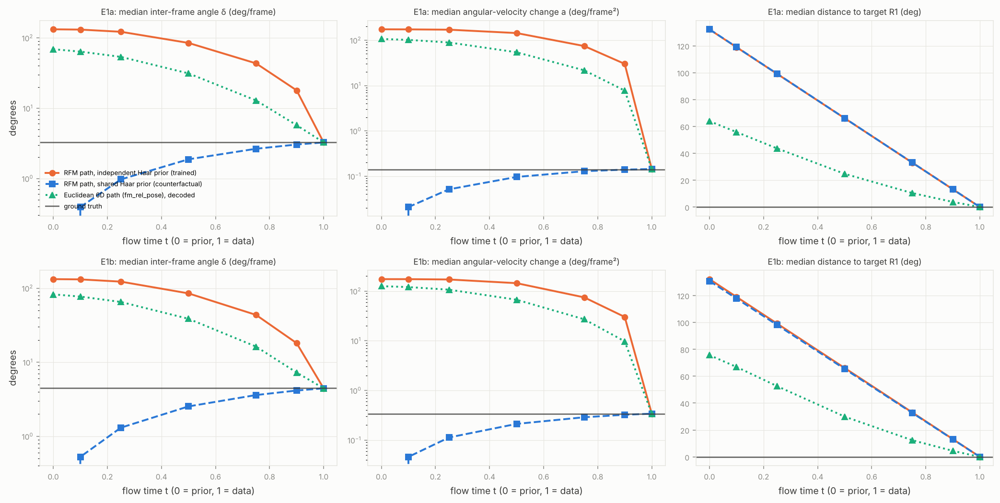

# Geometry-Aware Generative Modeling for Controllable Cinematic Camera Motion

## Abstract

Generating controlled camera motion requires balancing multiple desiderata: obeying start/end and subject conditions, covering alternative motion modes, preserving the desired probability distribution, and producing temporally coherent positions and orientations. We implement three from-scratch flow-matching variants—Euclidean relative-pose, Euclidean body-frame increment, and explicit SO(3)-aware Riemannian transport—and compare them on a controlled synthetic benchmark with known trajectory families. Under the evaluated single-seed setup, increment generation matches the ground-truth scale of translational jerk on E1a (0.96× versus 3.25× for the relative-pose baseline), but raises median endpoint error (1.89 cm versus 0.67 cm). The SO(3)-aware variant generates valid rotations yet shows poorer E1b orientation-excursion distribution fidelity (W1 4.82° versus 1.55°) and greater amplitude support violations (14.63% versus 5.52%). A subsequent diagnostic identifies long and temporally rough transport from independent Haar rotation priors and cut-locus behavior as plausible obstacles; their causal contribution remains unresolved. These findings suggest that correct manifold geometry alone is not sufficient to ensure high-quality temporal generation; parameterization, prior/path choice, and the sampler jointly matter.

## 1. Motivation and questions

A camera motion is a sequence of camera-to-world rigid poses whose rotation factors belong to SO(3). Treating rotation with a manifold-aware generative process is geometrically appealing, but its practical benefit depends on the data distribution and the specific training objective. We ask:

1. How do relative-pose and body-frame increment parameterizations trade off endpoint fidelity and temporal smoothness?
2. Does explicit SO(3) Riemannian transport improve orientation distribution fidelity relative to a continuous 6D rotation representation?
3. What path-level mechanisms might explain poorer performance of the SO(3)-aware method under the tested setup?

Our objective is a controlled synthetic *camera-motion* benchmark, not photorealistic video synthesis.

## 2. Experimental setup

### 2.1 Synthetic trajectory families

The E1a environment contains four orbit-like camera routes: short counterclockwise vs long clockwise, crossed with near vs far radii. Each shot request fixes its initial camera pose, terminal pose and subject; its data-generating route distribution is `(0.42, 0.28, 0.18, 0.12)`. E1b adds a continuous, hidden pan or roll excursion relative to look-at orientation (nominal amplitude 20–60°, peaked within the interior frames). Thus position alone does not determine orientation. A 32-frame pose trajectory is represented by its 31 generated frames relative to an anchored starting pose. E1a has held-out shot requests and a position-OOD panel; E1b is evaluated on held-out shot requests.

### 2.2 Generative methods

`fm_rel_pose` generates relative positions and a continuous 6D rotation code through a Euclidean FM path. Valid rotation matrices are obtained by Gram–Schmidt reconstruction. `fm_rel_inc` generates body-frame increments and integrates them from the anchored start pose. `rfm_so3` uses independent Haar-uniform SO(3) rotations as the rotational prior, per-frame geodesic interpolation and right-multiplicative SO(3) integration, with Euclidean transport for the positions. The two Euclidean models use a standardized Gaussian state prior. Consequently this is a **method-level comparison**, not a clean single-variable manifold-versus-Euclidean ablation.

### 2.3 Evaluation contract

We use the frozen `m2` evaluator with K=200 samples per condition and Euler NFE=50. The tracked objectives are: four-route coverage, five-category total-variation distance `TV5` against the declared route distribution, terminal pose errors, normalized translational jerk, and for E1b the Wasserstein-1 distance of the maximum orientation excursion and the fraction of amplitudes outside the known support. The oracle GT redraw, processed with matching K, sets a nonzero sampling floor for distribution metrics. Matched comparisons bootstrap paired condition-level differences; this does **not** measure variability over training seeds.

## 3. Quantitative results

**Table 1. Held-out ID results.** Values are preserved from the frozen benchmark. Lower is better for TV5, endpoint and W1. A jerk ratio of 1 means matching GT jerk magnitude, not necessarily matching its distribution or cinematic appearance.

| Metric | Relative pose | Body increment | SO(3) RFM |
|---|---:|---:|---:|
| E1a TV5 (oracle 0.0434) | 0.0526 | 0.0504 | 0.0743 |
| E1a terminal position error, median | 0.67 cm | 1.89 cm | 0.77 cm |
| E1a translational jerk / GT | 3.25× | 0.96× | 3.67× |
| E1b TV5 (oracle 0.0445) | 0.0524 | 0.0504 | 0.0738 |
| E1b terminal position error, median | 1.34 cm | 6.96 cm | 1.97 cm |
| E1b excursion W1 (oracle 0.253°) | 1.55° | 1.93° | 4.82° |
| E1b amplitude outside support | 5.52% | 5.27% | 14.63% |

All three models generated samples assigned to each of the four route modes. However, having nonzero *coverage* is not equivalent to reproducing the declared route probabilities. Relative-pose versus increment TV5 differences are small and do **not** exclude zero in paired condition bootstrap intervals: E1a `−0.0022 [−0.0095, +0.0054]`, E1b `−0.0020 [−0.0108, +0.00690]`. Relative-pose versus SO(3) RFM differences **do** exclude zero for ID TV5: E1a `+0.0217 [+0.0136, +0.0298]`, E1b `+0.0214 [+0.0122, +0.0305]` (SO(3) minus relative pose). At position-OOD E1a the SO(3) versus relative-pose TV5 interval includes zero; see the detailed CSV and comparisons.

**Important exclusion:** E1b translational jerk divided by GT was computed with different historical GT reference sets for at least some models. We retain those values in the original data for traceability but do not interpret them as a fully matched cross-model comparison. E1a jerk is matched.

## 4. Qualitative motion and orientation findings

**Figure 2.** A single held-out E1a request, visualized using 60 independent trajectories per group. All models express the four route families; the mode probabilities and endpoint quality are quantified across conditions in Table 1.

**Figure 3.** In E1b, the generated SO(3) trajectories occasionally depart from the smooth GT orientation-excursion envelopes, displaying excessive or irregular rotation. This visual example accords with the higher W1 and out-of-support rates, but is not a replacement for aggregate evaluation. Two synchronized MP4 comparison clips are supplied in `results/demo/`.

## 5. Diagnostic: why did the SO(3) method underperform?

We conducted a no-retraining path analysis using frozen E1a/E1b training samples. We compared the *trained* independent-Haar SO(3) interpolation path with an analytical, **untrained** shared-Haar prior counterfactual and the decoded Euclidean relative-pose path.

The independent-Haar SO(3) construction requires median per-frame rotation transport of approximately 132°. This is a displacement from the random prior rotation to its target and **must not be equated** with the GT inter-frame rotation (E1b median 4.5°). At flow time 0.5 the resulting path has median inter-frame angular difference of 85°, compared with 4.5° for the target. Even at flow time 0.9 it remains 18°; an untrained shared-Haar path instead produces 2.5° and 4.2° at these times. About 11% of Haar-to-target relative angles lie within 10° of π, where the principal SO(3) logarithm has nonunique branch behavior at the cut locus. Round-trip and orthogonality checks did not reveal a defective SO(3) implementation.

This supports a **plausible mismatch** between the chosen prior/transport construction and the temporal structure of the data. It does not prove that a correlated prior would yield better learned generations. Nor is independence alone a complete explanation: the Euclidean baseline also uses an independent prior but follows a different, shorter decoded rotation path. The synthetic GT rotations are smooth, and the 6D baseline already produces valid rotations; the benchmark did not expose a confirmed rotation-validity failure for explicit SO(3) transport to fix.

Existing solver sweeps show that finer integration improves certain errors (e.g. SO(3) RFM E1b translational jerk ratio at Euler NFE20 vs NFE100: 23.3→9.0), while orientation excursion W1 remains high (4.75°→5.11°). Thus a purely numerical-integration explanation is not supported, but the separate contributions of learning, prior, cut locus and representation remain unresolved.

See [`diagnostic_report.md`](../results/diagnostics/so3_transport/diagnostic_report.md) for complete statistics and caveats.

## 6. Discussion

The practical strength of the increment parameterization is the scale of local motion variation; its weakness is sensitivity of the reconstructed endpoint to accumulated increments. Error accumulation is a plausible mechanism, not directly established by a controlled time-resolved error decomposition. Relative poses reduce endpoint drift in this benchmark. Meanwhile, explicit SO(3) geometry enforces the manifold constraint but does not by itself align the training distribution with physically or aesthetically plausible temporal paths. A geometric representation should therefore be justified by a target-data pathology it actually addresses, and its transport prior/path should be audited in addition to the output geometry.

## 7. Limitations

- **Single training seed.** The paired confidence intervals are across matched held-out conditions, not repeated training runs.
- **Different methods vary in more than geometry**, including prior and numerical sampler; manifold geometry’s isolated causal contribution is unknown.
- **Synthetic data and simple software-rendered scene**, without movie-camera motion capture, real footage, user study or photorealistic video generation.
- **E1b jerk reference mismatch**, explicitly excluded from controlled cross-model conclusions.
- **Untrained prior counterfactual and diagnostics.** The path analysis identifies possible mechanisms, not an intervention showing improvement after changing the prior.
- No metric here alone measures artistic/cinematic quality.

## 8. Conclusion

The principal empirical result is not that a geometry-aware model is categorically worse, but that **representation and the choice of transport construction matter differently from the correctness of the underlying manifold**. Relative-pose and increment parameterizations show distinct endpoint–smoothness trade-offs; SO(3)-aware transport is geometrically valid yet did not reproduce orientation excursions as faithfully as the Euclidean 6D baseline under this setup. The next step is to present the frozen benchmark and rendered comparative demonstrations rather than training further models.
